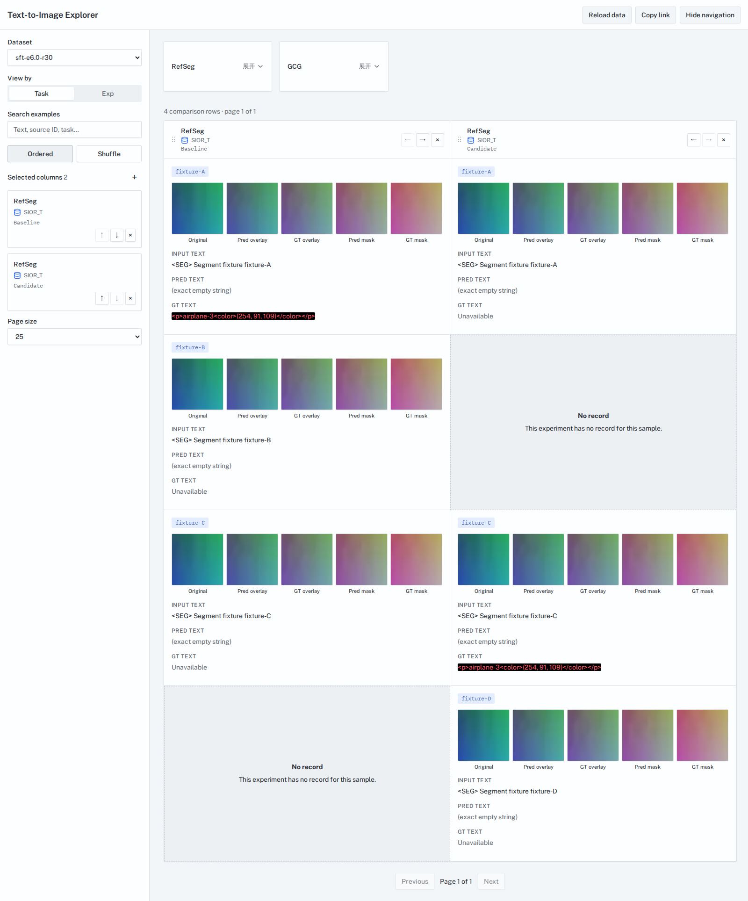
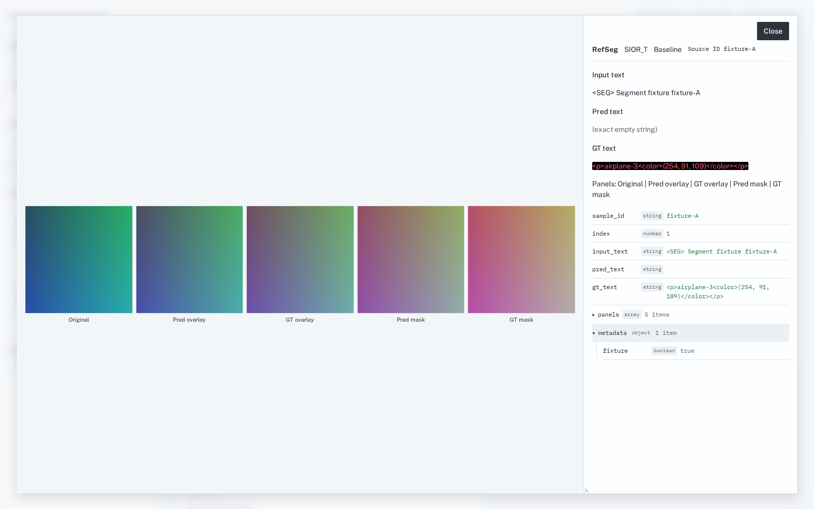
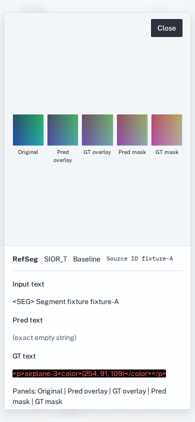

# Dive 浅色样式预览

截图来自生产构建与仓库内的 `fixtures/datasets`，图片是测试数据中的渐变图。
桌面视口为 1600 × 1000，手机视口为 390 × 844；普通页面保存完整页面，
详情弹窗保存当前视口。截图仅记录视觉变化，现有功能和数据含义保持不变。

| 页面 | 截图 |
| --- | --- |
| 首页 | [desktop-home.png](desktop-home.png) |
| Task 选择菜单 | [desktop-task-menu.png](desktop-task-menu.png) |
| Exp 选择菜单 | [desktop-exp-menu.png](desktop-exp-menu.png) |
| 多列比较 | [desktop-comparison.png](desktop-comparison.png) |
| 桌面详情弹窗 | [desktop-details.png](desktop-details.png) |
| 手机比较页 | [mobile-comparison.png](mobile-comparison.png) |
| 手机详情弹窗 | [mobile-details.png](mobile-details.png) |

## 桌面比较

## 桌面详情

## 手机详情

